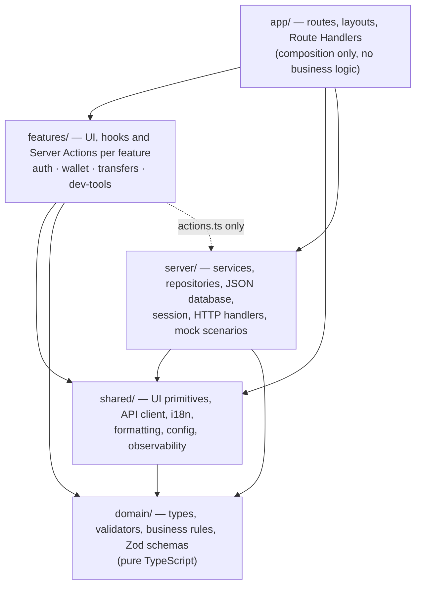
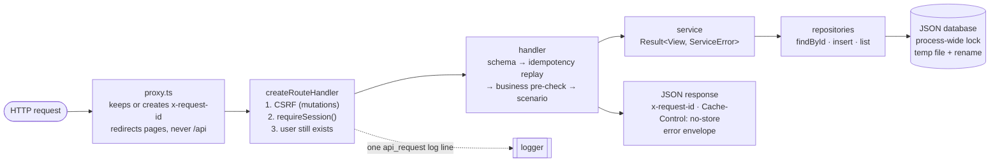
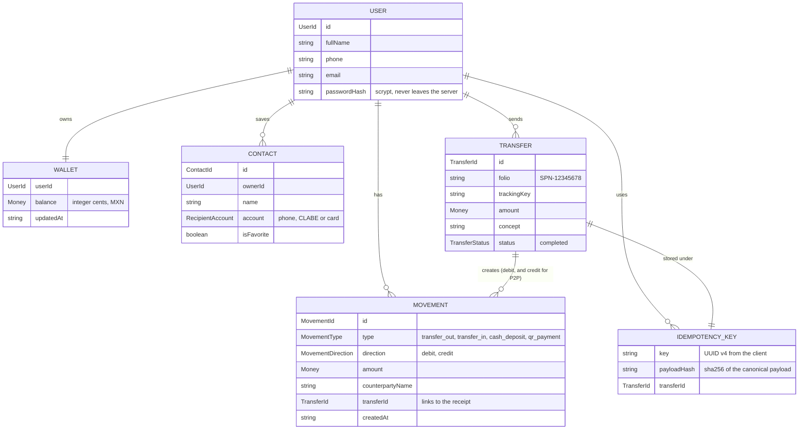

# Architecture

How the code is organized, what each layer may depend on, how a request travels through the simulated backend, and what the data looks like. For the reasons behind each choice, read [`DECISIONS.md`](../DECISIONS.md). For the full contract, read [`specs/00-architecture.md`](../specs/00-architecture.md).

## Contents

- [Layers](#layers)
- [Folders](#folders)
- [Backend pipeline](#backend-pipeline)
- [Data model](#data-model)
- [Where to find…](#where-to-find)

## Layers

The app has four layers plus the Next.js routes that compose them. Dependencies point inward: the domain knows nothing about React, Next.js or storage, and the server never knows about the UI.



These rules are enforced by `no-restricted-imports` in [`eslint.config.mjs`](../eslint.config.mjs), so a violation fails lint and CI:

| Layer | Cannot import |
| --- | --- |
| `src/domain/**` | `react`, `next`, `next-intl`, `@/server`, `@/features`, `@/shared/ui` |
| `src/server/**` | `@/features`, `@/shared/ui` |
| `src/features/<x>/**` | any other feature |
| `src/features/<x>/{components,hooks}/**` | `@/server` (only `actions.ts` files may) |
| `src/**` | `console` (except `src/shared/observability/**`) |

The rule that matters most for the challenge: **the three business rules live once, in `src/domain/transfer/rules.ts`**, and run in three places (the wizard, the Route Handler and the service). See [Data flows](./flows.md#transfer).

## Folders

```text
src/
  app/
    (public)/login, (public)/register        Server Action forms
    (private)/home                            SSR + streaming sections
    (private)/transfers/new/{amount,recipient,review}   client wizard
    (private)/transfers/[transferId]          SSR receipt
    api/v1/...                                Route Handlers, one line per method
    session/end                               clears a stale session cookie
  proxy.ts                                    route guard + x-request-id
  domain/      money/ user/ contact/ wallet/ transfer/ shared/
  server/      db/ repositories/ services/ session/ http/ mock/ auth/ wallet/ container.ts
  features/    auth/ wallet/ transfers/ dev-tools/
  shared/      ui/ lib/ i18n/ config/ observability/ styles/
  messages/es-MX/                             every user-facing string
  test/                                       Vitest setup, MSW, factories
e2e/                                          Playwright specs and fixtures
```

Every UI component lives in its own folder: `<name>.tsx`, `<name>.test.tsx`, `<name>.module.scss` (BEM) and a `types.ts` for its closed-set constants.

## Backend pipeline

The backend is simulated, but it is shaped like a real one. A Route Handler file is one line that binds a factory to its dependencies:

```ts
export const POST = createCreateTransferHandler(getHttpDependencies());
```

Every request goes through the same steps:



- **Dependency injection.** Services get `{ db, now, random, createId }`; handlers get `sleep`, `random`, `logger` and `reporter`. Tests control time, randomness and ids instead of mocking globals.
- **No exceptions for expected failures.** Validators and services return `Result<T, E>`. `requireSession()` is the only thing that throws, and `createRouteHandler` turns it into a `401`.
- **One error envelope.** `{ error: { code, message, requestId, details?, balance? } }`, where `message` is an i18n key. A full account number or password hash never leaves `src/server/`.
- **Swappable storage.** Services only see `Database` and `Repositories`. Replacing the JSON file with a real database touches neither services nor UI.

Server Components do not call their own API. Home's sections and the receipt call the services directly; client components use `/api/v1/*` through TanStack Query.

## Data model

Money is always integer cents (`Cents`, a branded number) with currency `MXN`. Ids are branded strings, so a `UserId` cannot be passed where a `TransferId` is expected. Dates are ISO 8601 in UTC and are formatted in `America/Mexico_City` only in the UI.



- **Stored as a snapshot.** A transfer stores the recipient's name and account at the moment it was sent, so editing a contact later never rewrites a receipt.
- **P2P inside one lock.** When the recipient is a phone that belongs to a registered user, the debit, the credit and both movements are written in the same transaction. CLABE and card recipients are external and only debit the sender.
- **Masked on the way out.** The API returns `AccountView { type, masked, bankName? }`, never the full account.
- **One file.** The whole database is `{ schemaVersion, users, wallets, movements, contacts, transfers, idempotencyKeys }` in `MOCK_DB_PATH`. A missing file or a different `schemaVersion` is regenerated from the seed (Mariana with $12,450.80 and 25 movements, Diego with $500.00 and none).

## Where to find…

| What | Where |
| --- | --- |
| The three business rules | [`src/domain/transfer/rules.ts`](../src/domain/transfer/rules.ts) |
| Money parsing and cents | [`src/domain/money/money.ts`](../src/domain/money/money.ts) |
| CLABE, card (Luhn), phone and email validators | `src/domain/*/validators.ts` |
| Every validation code (the domain never produces text) | [`src/domain/shared/validation-codes.ts`](../src/domain/shared/validation-codes.ts) |
| The HTTP contract shared by client and server | [`src/shared/lib/api/contract.ts`](../src/shared/lib/api/contract.ts) |
| The weighted scenarios and the read scenarios | [`src/server/mock/scenarios.ts`](../src/server/mock/scenarios.ts) |
| The transfer endpoint and its check order | [`src/server/http/handlers/create-transfer-handler.ts`](../src/server/http/handlers/create-transfer-handler.ts) |
| The transfer service (idempotency, debit, P2P credit) | [`src/server/services/transfer-service.ts`](../src/server/services/transfer-service.ts) |
| The JSON database and its lock | [`src/server/db/json-database.ts`](../src/server/db/json-database.ts) |
| The typed API client (`ApiFailure` union, timeout) | [`src/shared/lib/api/api-client.ts`](../src/shared/lib/api/api-client.ts) |
| Client state and the submission state machine | [State](./state.md) |
| Request sequences | [Data flows](./flows.md) |
