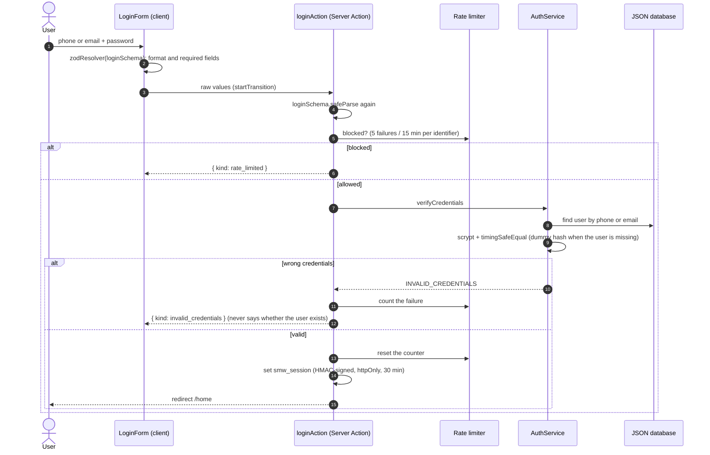
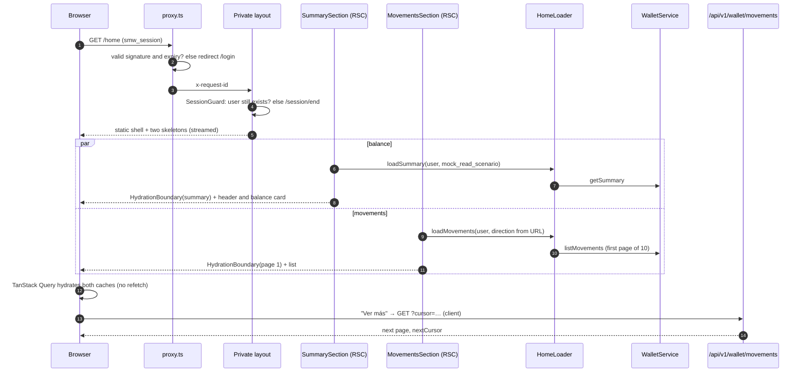
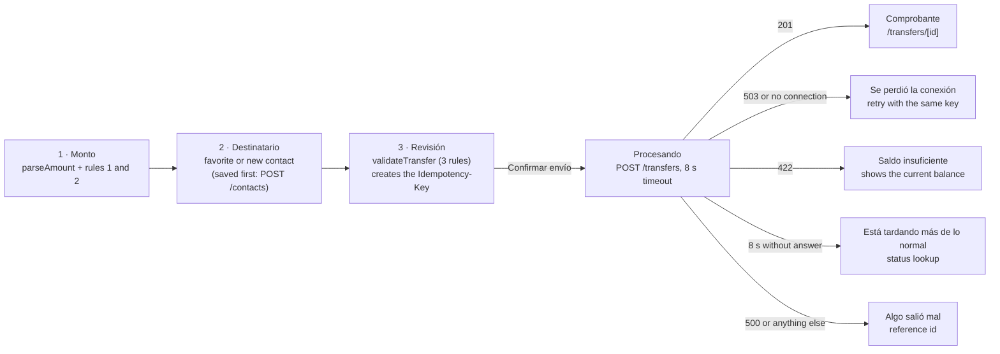
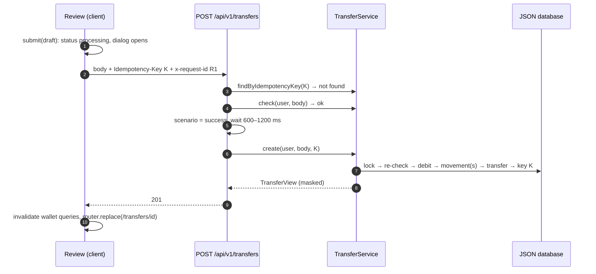
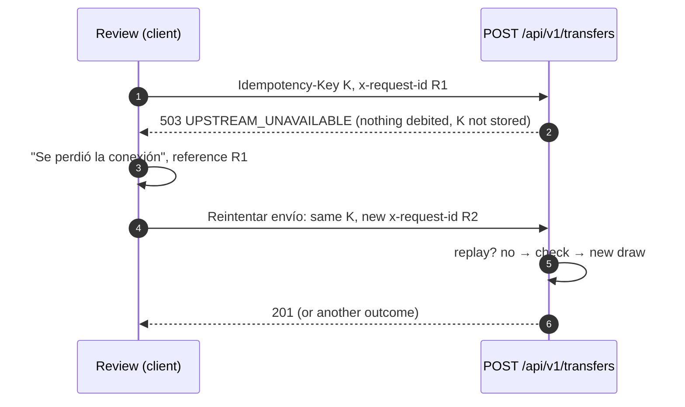
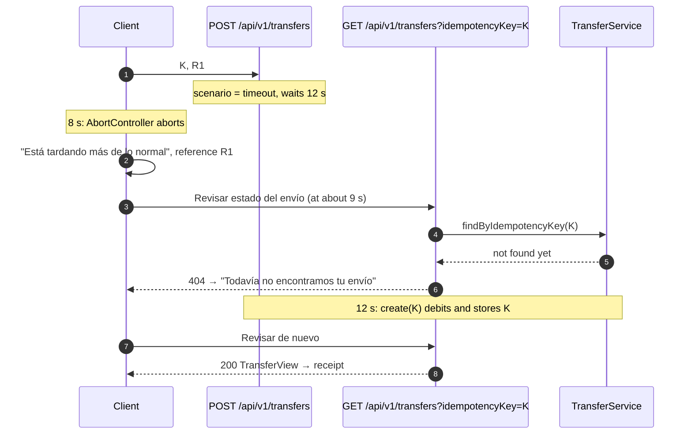

# Data flows

What happens, step by step, in the three flows a reviewer is most likely to question: logging in, loading Home, and sending money, including the failure paths. Layers and data shapes are in [Architecture](./architecture.md); client state is in [State](./state.md).

## Contents

- [Login](#login)
- [Home](#home)
- [Transfer](#transfer)
  - [Success](#success)
  - [Network error and retry](#network-error-and-retry)
  - [Timeout and status lookup](#timeout-and-status-lookup)

## Login

Login and registration are **Server Actions**, not REST endpoints: they set a cookie and redirect, and they live next to the form that uses them. The form validates with the same Zod schema on the client (instant feedback) and the server (the check that decides).

The session is a signed cookie, so any server instance can verify it without shared state. `proxy.ts` redirects pages based on it; Route Handlers and Server Actions check it again (`requireSession()`), so the proxy is never the only barrier.

## Home

Home renders on the server and **streams**: the static shell is sent at once, and the balance and the movements arrive as two independent `<Suspense>` sections. Their data is handed to TanStack Query on the client, so pagination continues without repeating the first load.

- **Partial failure.** Each section has its own `<Suspense>` and error boundary. If the movements fail, the balance stays visible. A failed server load is left out of the hydration, so the client query fetches by itself and one error state (with "Reintentar" and a reference id) covers both cases.
- **Demonstrable states.** The `mock_read_scenario` cookie (`slow`, `error`, `movements_error`) drives the same loading and error states on the server and in the API, so the reviewer can see them from the DEV panel.
- **Filter in the URL.** "Todos / Enviados / Recibidos" lives in `?direction=`, changed with `history.pushState`, so reload and back keep it.

## Transfer

The wizard keeps a draft on the client and validates each step with the domain rules. The server validates again before the scenario draw and once more inside the write lock.

On the server, `POST /api/v1/transfers` always runs its checks in this order, so invalid input never gets a simulated answer and a retry never charges twice:

1. CSRF (`Origin` and `Content-Type`) and session.
2. `Idempotency-Key` format, then the payload schema (integer cents, at most $999,999.99).
3. **Idempotency replay:** a key that already completed returns the stored transfer, with no new draw and no new debit.
4. **Business pre-check:** the contact belongs to the user, it is not the user's own phone, and the three rules pass against the real balance.
5. **Scenario draw:** 60 % success, 10 % each for network error, insufficient funds, timeout and unknown error (or the `mock_scenario` cookie).
6. On success, `TransferService.create` re-checks everything inside the lock, debits, writes the movement (and the P2P credit) and stores the key.

### Success

### Network error and retry

The key is created when the review step mounts and survives a reload and "Volver al inicio". It changes only when the amount, the concept or the recipient change, because the server answers `409` to the same key with a different payload.

### Timeout and status lookup

The `timeout` scenario makes the server wait 12 s and then complete the transfer. The client gives up at 8 s. At that moment the result is unknown, so the app never retries blindly and never says it failed.

If the user retries instead of checking, the request carries the same key: the replay check finds the completed transfer and returns it, so the money moves once.
