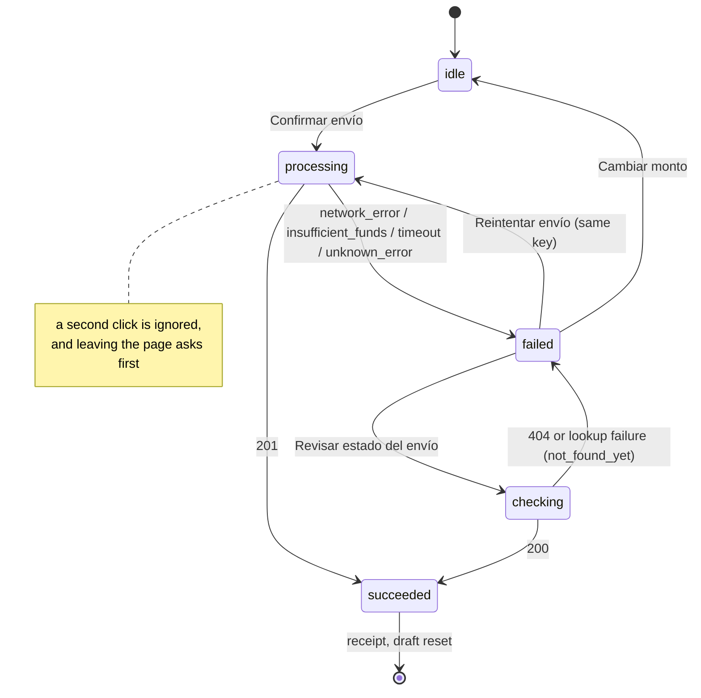

# State

Where each piece of state lives and why, the transfer submission state machine, and the two guards that decide which screen a user may see. The rule behind every choice: **server state is cached, not copied; UI state lives as close as possible to where it is used.**

## Contents

- [Map of the client state](#map-of-the-client-state)
- [Submission state machine](#submission-state-machine)
- [Wizard step guard](#wizard-step-guard)
- [Route access](#route-access)

## Map of the client state

| State | Lives in | Persisted | Why there |
| --- | --- | --- | --- |
| Balance and user name | TanStack Query (`walletQueryKeys.summary`) | No | Server state: cached, deduplicated, invalidated after a transfer, hydrated from SSR |
| Movements pages | TanStack Query infinite query, one key per filter | No | Cursor pagination and retries without custom code |
| Favorite contacts | TanStack Query (`contactQueryKeys.list`) | No | A new favorite is written into the cache, so it shows without a refetch |
| Movements filter (Todos / Enviados / Recibidos) | URL `?direction=` | Yes, in the URL | Reload, back and a shared link keep the selection |
| Hide balance | `smw_balance_hidden` cookie | Yes | The server reads it, so the first paint is already hidden, with no flash |
| Transfer draft (amount, concept, masked recipient, owner, idempotency key) | Zustand + `persist` over `sessionStorage` (`smw.transfer-draft`) | Per tab | Survives a reload mid-wizard; dies with the tab; holds only masked data |
| Live preview while typing | Zustand, not persisted | No | Lets the desktop summary update before "Continuar" without touching the draft |
| Submission status and outcome | Zustand, not persisted | No | Shared by the review, the processing dialog and the shell's focus mode |
| New-recipient form open | URL `?mode=new` | In the URL | The browser back button closes it |
| Session | `smw_session` httpOnly cookie | 30 min | Readable by the server for SSR; invisible to JavaScript |

Logging out, or any `401`, calls `clearClientSession()`: it removes the `sessionStorage` draft and notifies the in-memory stores, which reset themselves. A draft left by another account in the same tab is discarded the first time the wizard sees the new user (`claim(ownerId)`).

Why not one global store: TanStack Query already solves caching, retries, invalidation and pagination for server data; putting that data in Zustand or Redux would mean keeping two copies in sync. Zustand covers the little that is truly client-only, with no provider and a few lines per store.

## Submission state machine

`src/features/transfers/submission/submission-store.ts` holds one discriminated union; every screen renders from it with an exhaustive `switch`.

| Outcome | Screen | Action |
| --- | --- | --- |
| `network_error` (503 or no connection) | "Se perdió la conexión" — no charge was made | Reintentar envío (same key) |
| `insufficient_funds` (422) | "Saldo insuficiente" with the current balance and the amount | Cambiar monto |
| `timeout` (8 s without an answer) | "Está tardando más de lo normal" | Revisar estado del envío |
| `not_found_yet` (lookup found nothing) | "Todavía no encontramos tu envío" | Revisar de nuevo · Reintentar envío |
| `unknown_error` (500, 409, anything else) | "Algo salió mal" with the reference, reported to the `ErrorReporter` | Volver al inicio |

Every failure screen shows the request id as "Referencia" with a "Copiar" button, and it matches the server's `api_request` log line.

## Wizard step guard

The proxy cannot see `sessionStorage`, so each step checks the draft on the client after it rehydrates, and replaces the URL with the first incomplete step. `resolveStepAccess` is a pure function:

| Requested step | Draft | Shown step |
| --- | --- | --- |
| `amount` | anything | `amount` |
| `recipient` | no amount | `amount` |
| `recipient` | amount | `recipient` |
| `review` | no amount | `amount` |
| `review` | amount, no recipient | `recipient` |
| `review` | amount and recipient | `review` |

## Route access

`resolveRouteAccess(pathname, hasSession)` in `src/shared/lib/routes.ts` is the single table the proxy applies:

| Path | Without a session | With a session |
| --- | --- | --- |
| `/` | → `/login` | → `/home` |
| `/login`, `/register` | page | → `/home` |
| `/home/**`, `/transfers/**` | → `/login` | page |
| `/api/**` | never redirected; the handler answers `401` JSON | handler |
| `/session/end` | clears the cookie, → `/login` | clears the cookie, → `/login` |

A session is "valid" when its HMAC signature and its expiry check out. If the signed user no longer exists (on Vercel each instance has its own database), the private layout's `SessionGuard` and any `401` from the API send the browser to `/session/end`, which deletes the cookie. Clearing it there matters: with the cookie still set, the proxy would bounce `/login` back to `/home`.
